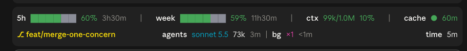
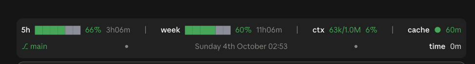

# fleet-street

Usage and Status Banner Plugin for Claude

**With subagents or background tasks running:** the middle of row 2 lists them.



**With no subagents or background tasks running:** the middle of row 2 shows the date and time instead, so
the row never looks empty.



## What it shows

| Row | Part | What it shows |
| --- | --- | --- |
| 1 | `5h` | 5-hour usage as a bar and a percentage, with time until it resets |
| 1 | `week` | Weekly usage, the same way |
| 1 | `ctx` | Context used out of the window, as tokens and a percentage |
| 1 | `cache` | Prompt-cache countdown. It turns yellow in the last five minutes and red in the last minute |
| 2, left | branch | The git branch: green on the main branch, yellow on any other |
| 2, middle | `agents` | Each running subagent with its model, tokens used and how long it has run |
| 2, middle | `bg` | Each background task with how long it has run |
| 2, middle | date and time | Shown only when no agents or background tasks are running, with a faint dot on each side |
| 2, right | `time` | How long the session has been running |

Bars and percentages go green, yellow, then red as usage rises. After a long gap, a prompt asks whether to
keep the session timer going.

## Install

```bash
./install.sh
```

This links the repo at `~/.claude/mods/fleet-street`. If a real folder is already there, it is moved to
`~/.claude/backups/fleet-street.<timestamp>`, never deleted. The script is safe to run again.

Claude Code loads the mod through `CLAUDE_CODE_PLUGIN_DIRS`. If `~/.claude/settings.json` doesn't name the
path yet, the script prints the line to add to its `env` block:

```json
"CLAUDE_CODE_PLUGIN_DIRS": "/Users/<you>/.claude/mods/fleet-street"
```

Uninstall with `./install.sh --uninstall`, which removes the link and nothing else.

## Options

Set in the plugin's config:

| Option | Default | What it does |
| --- | --- | --- |
| `awayMinutes` | `30` | Minutes without activity before the banner asks whether to keep the session timer going |
| `mainBranch` | `main` | The branch shown in green; any other branch is shown in yellow |

## Develop

Edit `hooks/register.tsx`. Check it with:

```bash
claude plugin validate .
```

`tsconfig.json` extends `.claude-plugin/types/tsconfig.json`, which is generated and not committed. Run
`/plugin-types` in Claude Code to write it before type-checking in an editor.

The banner is drawn on terminal and desktop surfaces. The desktop surface uses proportional text, so don't
size anything from the column count; keep decorations to fixed, single-character pieces.
