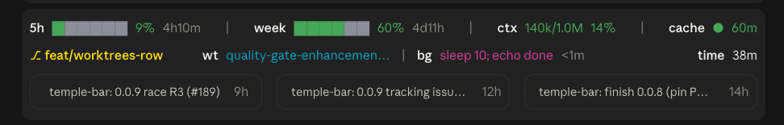
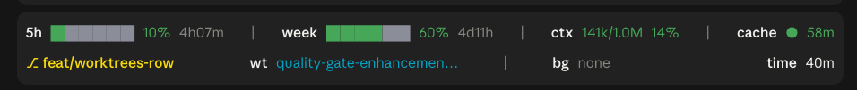

# fleet-street

Usage and Status Banner Plugin for Claude

**With the recent-sessions row:** the banner with another worktree and a background task running.



**Without it:** `/toggle-sessions` hides or shows the row for the session.



## What it shows

- **Row 1: the repository**, left and right, with a light rule under it as the banner's header
  - Left: the repository, as its GitHub owner (bold) and name (`londontypescript/fleet-street`); clicking the
    name opens the repository on GitHub. Else its top
    folder's name, else the session's folder outside a git repository. In a folder named otherwise (a
    worktree's), the folder follows it: `fleet-street · pin-worktree`
  - Right: `ms`, the milestone being worked on, with a bar, a count of its issues closed out of all of them,
    and the headline of its description (`0.2.0 ██░░░░ 3/22 Agent rules and the merge loop`). The headline is
    the description's words before its first colon and space (`: `), else its first sentence, with a footer after a `---` line
    left out. The milestone is the one the `milestone` option names, else the open milestone with the lowest
    version number (compared as versions, so `0.0.10` comes after `0.0.9`), else the open one made first; not
    shown when the repository has no open milestone. The title is blue, like the bar. Clicking the headline
    opens the milestone on GitHub. Read with `pr`'s refresh and needs the same
  - When the row runs out of room, the owner and the folder are left out, then the headline is cut to 32, then
    16, then left out, then the milestone's bar is left out, then the milestone
- **Row 2: usage**, left to right
  - `5h`: 5-hour usage as a bar and a percentage, with the time until it resets
  - `week`: weekly usage, the same way
  - `ctx`: context used out of the window, as tokens and a percentage. It turns yellow at 70% or 300k tokens
    and red at 90% or 450k tokens, whichever comes first, so on a 1M window it warns when a session is worth
    handing over (`contextWarnTokens`, `contextHandoverTokens`)
  - `cache`: the prompt-cache countdown, yellow in the last five minutes and red in the last minute
- **Row 3: status**, left to right
  - Left: the git branch, green on the main branch and yellow on any other, with its diff beside it: the files
    changed and the lines added and deleted since the branch left the expected branch (`mainBranch`),
    uncommitted work and new files included (the lines of the first 200 new files), as `8 files +152 −32`, and
    not shown when there's nothing. A renamed file counts once. It compares with the merge-base of `HEAD` and
    `origin/<mainBranch>` (the local `<mainBranch>` when there's no such remote branch), as the refs stand
    locally: nothing is fetched
  - Middle: the track Apple Music is playing, as `♪ Song — Artist`, else the date and time (`Sat 25 Oct
    18:42`, in the machine's time zone). Music is asked every five seconds through AppleScript (`osascript`),
    on a Mac only; it isn't started to ask. Clicking the track brings Apple Music to the front. The first time, macOS asks whether Claude may control Music
    (System Settings → Privacy & Security → Automation); until it's allowed, the date shows
  - Right: `time`, how long the session has been running
  - With a diff showing, the track (or the date and time) sits on the right beside `time`, away from the
    diff; without one it's centred
  - The track is cut to the room left: the title is cut and the artist kept whole
    (`♪ Let's Go (feat. Yelawolf, Twi… — Trick Daddy`), and only with under 8 characters left for the title is
    the artist cut too. The file count always shows with the diff. When the row runs out of room, the date is
    left out (keeping the time), then the middle (a track that would be cut under 16 characters), then the
    diff
- **The list rows** below it each appear only while they have something to show, so a quiet session is three
  rows tall. Rows have a blank line between them while they all fit in the space the app gives the banner
  (at most half the terminal); when they wouldn't, they're packed tight. Each is a label and its entries; when a row runs out of room it is squeezed a step at a time, as
  each row's entry says (full titles first), and on a row too narrow even for its last step the row is left
  out. The label stays on the left and the entries are spread in columns across the rest of the width, each
  centred in its own, with `│` between them; the spare width is shared evenly, so a longer entry gets a wider
  column.
  - `subs`: the desktop sessions this one started (its sub-sessions), not archived, those needing you first,
    each by the short name it was started with (else its title), with a mark and how long since it last did
    anything. Clicking a name opens the session. Each session's record in the desktop app names the session
    that started it; what it's doing comes from the end of its transcript. `●` working (light blue): mid-turn. `⚠` needs
    you: its turn ended blocked on you (its wrap-up said so), or it's held on a question, a plan to approve or
    a session it offered. `◐` background (light blue): between turns, but its own banner shows subagents or
    background tasks running, counted after its name (`◐ gu-port 1x ag 2x bg`). Each session writes what it
    has running to `fleet-street/activity/<session id>.json` in Claude's configuration folder, and again every
    30 seconds while anything runs; a file older than 90 seconds is ignored. `○` waiting: between turns
    otherwise. A transcript untouched for 30 minutes counts
    as waiting whatever its end says, as its session stopped without closing the turn. A permission prompt
    can't be told from a long tool call, so it counts as working. Not shown in the terminal, which has no such
    records. Squeezed: names cut to 24, then 12, then counted by what they're doing (`● 3 working │ ◐ 1
    background │ ○ 2 waiting │ ⚠ 1 needs you`), then tighter (`●3 ◐1 ○2 ⚠1`)
  - `ag`: this session's subagents, from Claude Code's own agent list, each with its description, its model and
    effort (`Opus High`, `Sonnet Med`, from its first step), a mark (`●` running, `○` waiting or idle, `✓` done, `✗` failed) and how long it has run. A finished
    one stays for two minutes. Background runs of ChatGPT through the Codex CLI (`codex-locked`, `codex exec`)
    are listed here too, as `Sol High` and the like, read from the command's `-m` and
    `model_reasoning_effort`. Squeezed: descriptions cut to 24, then 12, then left out, then grouped by model
    (`Opus High ×2 ●`), then `×N` with the most urgent mark
  - `bg`: the background shells and monitors, each by the description Claude gave its call (the title the
    app's task list shows; the command when there is none), with how long it has run. Squeezed: labels cut to
    32, then 16, then the first ones and `+N`, then `×N` with the oldest one's age
  - `wt`: the repository's other worktrees that you made, each by its branch (by its folder when detached).
    Subagents' worktrees (`.claude/worktrees/agent-…`) are left out: their agents are on `ag`. Squeezed: names
    cut to 24, then 12, then the first ones and `+N`, then `×N`
  - `pr`: the open pull requests whose branch is this session's branch or one of the worktrees' (this
    session's first; at most 10 branches are looked up). Each shows its number, its title and its checks as
    passed out of the total: `● 2/4` light blue while any are running, `✗ 3/4` red as soon as one fails, `✓ 4/4`
    green when all pass (skipped and neutral checks count as passed). The total includes the checks the PR's
    base branch requires (by its rulesets or its branch protection, asked for every five minutes; an answer that can't be refreshed counts for 30 minutes) that haven't
    reported yet; while any haven't and none failed or runs, it shows `○ 4/15` in light blue. A red `⚠` after the
    title means the PR conflicts with its base: GitHub doesn't start the workflows a `pull_request` event runs
    until the conflict is resolved, so those checks never come. A draft is dimmed. Clicking a title opens
    the PR; it shows as a button on hover. PRs from forks are left out. Each branch's PRs are asked for
    every 15 seconds while any of their checks are running, every 60 seconds otherwise, and at once for a new
    branch. It needs `gh`, signed in, and an `origin` remote on github.com; when `gh` can't answer there's no
    row. If a refresh fails after one has worked (offline, say), the last list stays, dimmed. Squeezed: titles
    cut to 32, then 16, then left out, then `×N` with the worst mark. A failed check is named after the count
    (`✗ 3/4 windows`), the first two at full width and the first one once squeezed, before the titles are cut
    further
  - `ci`: the latest run of each workflow that a push, a dispatch, a release or a schedule started (a release
    check, a run on the main branch after a merge), not a PR's, which are on `pr`, nor those of CodeQL's
    default setup or of issue triggers (a CodeQL workflow of your own that runs on push does show). Each
    shows its jobs passed out of the total, marked as on `pr`, with the failed ones named; a run that failed
    or was cancelled is marked failed whatever its jobs say. A run stays while it runs and for ten minutes
    after it finishes; at most three. Read with `pr`'s refresh, at its faster pace while one runs. Squeezed:
    names cut to 24, then 12, then the failed names left out, then `×N` with the worst mark
- **Shared with every session**: what GitHub says (each branch's PRs, the milestones, the runs, the required
  checks) is kept in small files under `~/.claude/fleet-street/github/<owner>__<repo>/` (under
  `CLAUDE_CONFIG_DIR` when that's set), and every session reads them every five seconds. A session asks GitHub
  only for what's due and that no other session has set out to fetch in the last 30 seconds, so ten sessions
  on one repository cost what one does. A rate-limit reply holds every session off GitHub for five minutes. A
  failed fetch is tried again after a minute; an answer more than five minutes old shows dimmed.
- **Recent sessions**, the last row, off unless turned on: the three most recently active other sessions in the
  desktop app, from any project, each in its own box with its title and how long ago it was last active.
  Clicking a title opens that session. `/toggle-sessions` shows or hides the row for the session, and
  `showSessions` turns it on for good. While it's hidden nothing is scanned. The sessions are read from the
  desktop app's data folder (`%APPDATA%\Claude` on Windows, `~/Library/Application Support/Claude` on macOS,
  `~/.config/Claude` on Linux); on a machine without the desktop app the row is not drawn.

Bars and percentages go green, yellow, then red as usage rises. After a long gap, a prompt asks whether to
keep the session timer going.

## Install

```bash
./install.sh
```

It needs `jq`. The script does two things, then asks you to start a new Claude Code session:

- Links the repo at `~/.claude/mods/fleet-street`. If a real folder is already there, it is moved to
  `~/.claude/backups/fleet-street.<timestamp>`, never deleted.
- Adds that path to `env.CLAUDE_CODE_PLUGIN_DIRS` in `~/.claude/settings.json`, which is how Claude Code
  loads the mod. Any paths already listed there stay, separated by `:`. The file is backed up to
  `~/.claude/backups/settings.json.<timestamp>` first.

It is safe to run again. `./install.sh --uninstall` removes the link and this one path from settings,
and nothing else.

## Options

Set in the plugin's config:

| Option | Default | What it does |
| --- | --- | --- |
| `awayMinutes` | `30` | Minutes without activity before the banner asks whether to keep the session timer going |
| `mainBranch` | `main` | The branch shown in green; any other branch is shown in yellow |
| `showWork` | `true` | Show the milestone and the diff beside the branch, and the `pr` and `ci` rows |
| `showSessions` | `false` | Show the row of recent sessions |
| `contextWarnTokens` | `300000` | Context size at which `ctx` turns yellow, whatever its percentage |
| `contextHandoverTokens` | `450000` | Context size at which `ctx` turns red |
| `milestone` | (empty) | The milestone `ms` follows, by its title; empty picks the open one with the lowest version |

## Commands

- `/reset-timer` restarts the session timer.
- `/toggle-sessions` shows or hides the recent-sessions row for the current session, whatever
  `showSessions` says.

## Develop

Edit `hooks/register.tsx`. Check it with:

```bash
claude plugin validate .
```

`tsconfig.json` extends `.claude-plugin/types/tsconfig.json`, which is generated and not committed. Run
`/plugin-types` in Claude Code to write it before type-checking in an editor.

The banner is drawn on terminal and desktop surfaces. The desktop surface uses proportional text, so a line's
character count only estimates its width there (the rows count it at 85%); keep decorations to fixed,
single-character pieces.
